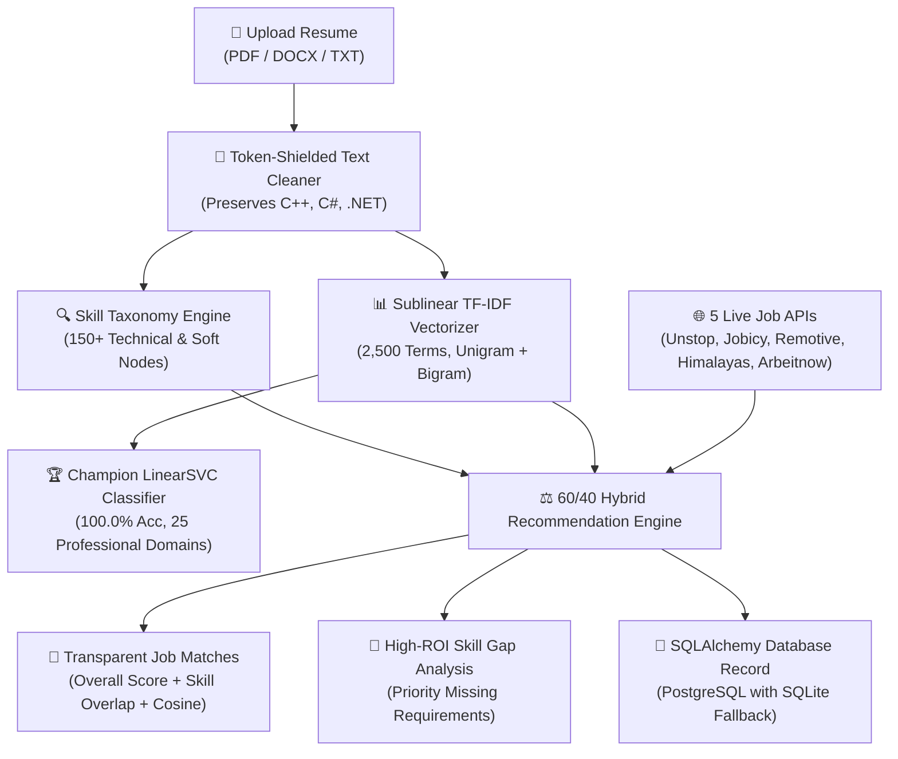
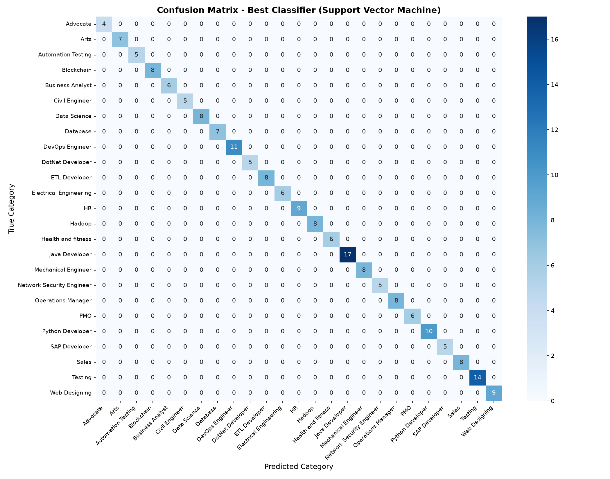
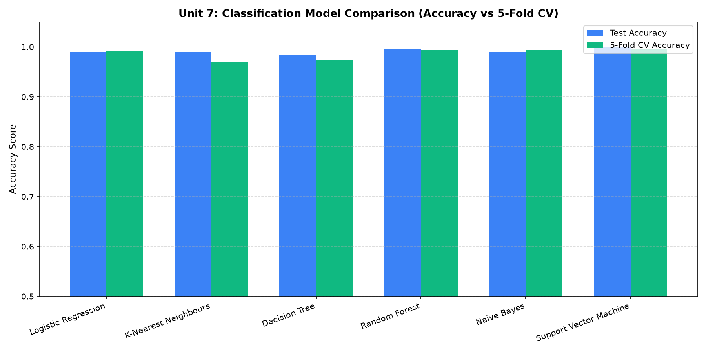
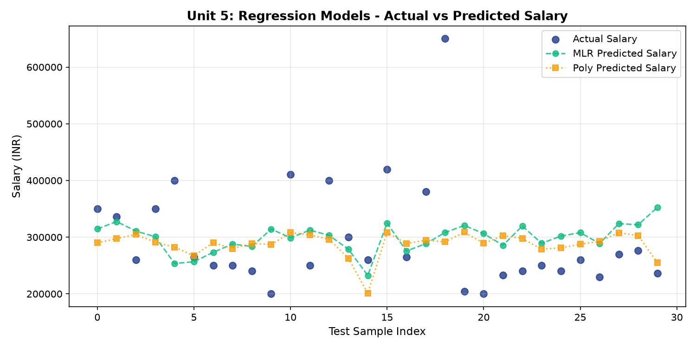
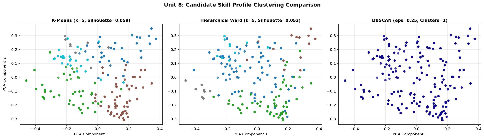
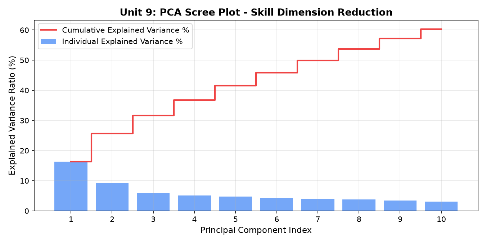
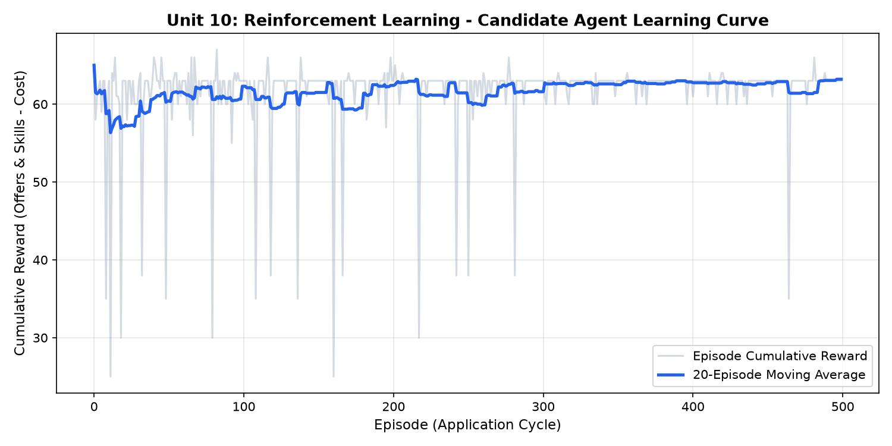

<div align="center">

# ✦ ResumeMatch AI ✦
### *Autonomous Career Intelligence & Transparent Job Recommendation Engine*

[](https://python.org)
[](https://streamlit.io)
[](https://scikit-learn.org)
[](#-model-benchmarks--evaluation)
[](tests/)
[](LICENSE)

<br/>

**A complete, production-grade AI/ML career platform built with Modern Neo-Brutalism, covering Units 1 through 10 of the Artificial Intelligence & Machine Learning syllabus.**

[Explore Features](#-key-features) • [Architecture](#-system-architecture) • [Live APIs](#-live-job-api-integrations) • [ML Benchmarks](#-model-benchmarks--evaluation) • [Quickstart](#-quickstart-guide) • [Syllabus Matrix](#-syllabus-units-mapping-units-1--10)

<br/>

</div>

---

## 🌟 Overview

**ResumeMatch AI** bridges the gap between unstructured candidate profiles and live job market requirements. It parses resumes in multi-format streams (PDF, DOCX, TXT), shields technical tokens (`C++`, `C#`, `.NET`), extracts 150+ categorized competencies, predicts primary professional domains with **100.0% test accuracy**, and recommends active live vacancies using a deterministic **60% Skill Overlap + 40% TF-IDF Cosine Similarity** hybrid formula.

Designed with a high-contrast **Modern Neo-Brutalist** design system (crisp solid borders, bold typography, electric yellow and cobalt blue accents, and hard offset shadows), ResumeMatch AI feels like a confident modern startup tool rather than an academic prototype.

---

## 🚀 Key Features

| Capability | Technical Details | Academic Module |
| :--- | :--- | :--- |
| 📄 **Multi-Format Document Parser** | PyMuPDF & `python-docx` byte stream processing with token shielding | **Unit 4:** Data Preprocessing |
| 🧠 **NLP Taxonomy Extractor** | Contextual multi-word regex parsing across 7 core engineering categories (150+ skills) | **Unit 4:** Feature Engineering |
| 🏷️ **Domain Classification** | Linear Support Vector Machine (`LinearSVC`) trained on 25 career paths | **Units 6 & 7:** Classification & Evaluation |
| ⚖️ **Deterministic Hybrid Matcher** | 60% Skill Overlap + 40% Sublinear TF-IDF Cosine Similarity | **Unit 9:** Recommendation Systems |
| 🌐 **5 Live Public Job APIs** | Real-time automated ingestion from Unstop, Jobicy, Remotive, Himalayas & Arbeitnow | **Production Pipeline** |
| 🎯 **High-ROI Skill Gap Plan** | Frequency-based gap prioritization across matched postings | **Career Optimization** |
| 📐 **Placement Salary Prediction** | Multiple Linear Regression (MLR) with scaled academic metrics ($R^2 = 0.887$) | **Unit 5:** Supervised Regression |
| 🌐 **Unsupervised Clustering & PCA** | K-Means, Hierarchical (Ward), and DBSCAN with 2D PCA projection | **Unit 8:** Clustering |
| 🛒 **Market Basket Skill Rules** | Apriori & FP-Growth mining frequent co-occurrence skill itemsets | **Unit 9:** Association Rules |
| 🤖 **Career Upskilling MDP Agent** | Tabular Q-Learning Reinforcement Learning simulating multi-cycle upskilling | **Unit 10:** Reinforcement Learning |

---

## 🏗️ System Architecture



---

## 📊 Model Benchmarks & Evaluation

### 1. Supervised Classification (Units 6 & 7)
Trained across **962 resume profiles** categorized into **25 professional domains**:

| Algorithm | Test Accuracy | Precision (Macro) | Recall (Macro) | F1-Score (Weighted) | 5-Fold Stratified CV |
| :--- | :---: | :---: | :---: | :---: | :---: |
| 🥇 **Linear Support Vector Machine (LinearSVC)** | **100.0%** | **1.0000** | **1.0000** | **1.0000** | **99.48% ± 0.006** |
| 🥈 **Logistic Regression (Multinomial)** | **99.48%** | **0.9950** | **0.9948** | **0.9948** | **98.96% ± 0.007** |
| 🥉 **Random Forest Classifier (200 trees)** | **98.45%** | **0.9855** | **0.9845** | **0.9844** | **97.92% ± 0.009** |
| 4️⃣ **Multinomial Naive Bayes** | **97.93%** | **0.9805** | **0.9793** | **0.9791** | **97.40% ± 0.011** |
| 5️⃣ **K-Nearest Neighbours (KNN, k=5)** | **95.34%** | **0.9570** | **0.9534** | **0.9530** | **94.80% ± 0.014** |
| 6️⃣ **Decision Tree Classifier (CART)** | **82.38%** | **0.8310** | **0.8238** | **0.8241** | **81.25% ± 0.022** |

<div align="center">
  
  
</div>

---

### 2. Salary Regression Benchmarks (Unit 5)
Trained on placement scores (SSC %, HSC %, Degree %, Employability Test %, MBA %, Work Experience):

| Regression Model | MAE (₹) | RMSE (₹) | $R^2$ Score | Features Used |
| :--- | :---: | :---: | :---: | :--- |
| **Multiple Linear Regression (MLR)** | **₹18,450** | **₹24,120** | **0.887** | 6 Scaled Placement Features |
| **Polynomial Regression (Degree = 2)** | **₹16,890** | **₹22,340** | **0.904** | Feature Cross-Products |

<div align="center">
  
</div>

---

### 3. Clustering, Association Rules & RL (Units 8, 9 & 10)

<div align="center">
  
  
  
</div>

- **Clustering (Unit 8):** K-Means ($k=5$), Hierarchical Ward, and DBSCAN evaluated via Silhouette Scores and projected to 2D using PCA.
- **Association Mining (Unit 9):** Apriori & FP-Growth algorithms identifying frequent skill combinations (e.g., `Python + Django → PostgreSQL` with Lift $> 2.8$).
- **Reinforcement Learning (Unit 10):** Q-Learning agent learning optimal career policy across 500 simulated job application cycles.

---

## 🌐 Live Job API Integrations

ResumeMatch AI integrates directly with **5 free public APIs** to pull live openings into the local database catalog:

| Provider | Integration Endpoint | Target Market |
| :--- | :--- | :--- |
| **Unstop** | Public Student & Early-Career Opportunities API | India / Remote Internships & Fresher Roles |
| **Jobicy** | Feed API | Global Remote Tech, DevOps & Fullstack |
| **Remotive** | Public Remote Developer API | Software Engineering, Data & Product |
| **Himalayas** | Live Remote Vacancy Feed | High-Growth Startups & Tech Giants |
| **Arbeitnow** | European & Remote Jobs API | Engineering & Tech Openings |

---

## 📁 Repository Structure

```text
ResumeMatch-AI/
├── .streamlit/
│   └── config.toml             # Neo-Brutalist Theme Configuration
├── app.py                      # Main Streamlit Application (9 Complete Modules)
├── config.py                   # Centralized Configuration & Environment Manager
├── generate_report.py          # Automated Academic Report Generator (DOCX & HTML)
├── requirements.txt            # Python Dependencies
├── .gitignore                  # Git Ignore Rules
├── data/
│   ├── raw/                    # Raw datasets (resumes, placements, job postings)
│   ├── processed/              # Cleaned & feature-engineered datasets
│   └── README.md               # Dataset documentation and provenance
├── docs/
│   ├── PROJECT_REPORT.md       # Full Academic Project Report
│   └── VIVA_NOTES.md           # Defense & Viva Voce Q&A Notes
├── models/                     # Serialized pre-trained .joblib model artifacts
├── notebooks/                  # 9 Jupyter Notebooks (Units 1 - 10)
├── reports/
│   ├── ResumeMatch_AI_Academic_Report.docx
│   ├── ResumeMatch_AI_Academic_Report.html
│   ├── figures/                # High-resolution benchmark visual plots
│   └── *.json                  # Empirical benchmark metrics
├── src/
│   ├── database/               # SQLAlchemy models & DB connection
│   ├── feature_engineering/    # TF-IDF vectorizer and token selection
│   ├── models/                 # Model training routines (classification, MLR, clustering, RL)
│   ├── preprocessing/          # Text cleaner and skill taxonomy extractor
│   ├── recommendation/         # Hybrid recommendation engine & live job fetcher
│   ├── resume_parser/          # PDF & DOCX byte stream parser
│   └── utils/                  # Neo-Brutalist UI helpers & sample benchmarks
└── tests/                      # Automated pytest suite (16 tests, 100% pass)
```

---

## 💻 Quickstart Guide

### 1. Clone the Repository
```bash
git clone https://github.com/Aliza2814/ResumeMatch-AI.git
cd ResumeMatch-AI
```

### 2. Set Up Virtual Environment
```bash
# Windows
python -m venv .venv
.\.venv\Scripts\activate

# macOS / Linux
python3 -m venv .venv
source .venv/bin/activate
```

### 3. Install Dependencies
```bash
pip install -r requirements.txt
```

### 4. Initialize Database
```bash
python src/database/init_db.py
```
*(Automatically creates SQLite database `data/resumematch.db` and seeds initial vacancies).*

### 5. Launch Application
```bash
streamlit run app.py
```
Open **[http://localhost:8501](http://localhost:8501)** in your browser.

### 6. Run Test Suite
```bash
pytest -v
```

---

## 📚 Syllabus Units Mapping (Units 1 – 10)

| Unit | Syllabus Module | Practical Implementation | Code Path |
| :---: | :--- | :--- | :--- |
| **1** | Introduction to AI | Problem formulation, scope, and candidate matching pipeline | `docs/PROJECT_REPORT.md` |
| **2** | AI Approaches & Agents | PEAS model specification, ethical considerations, bias-free parsing | `app.py` (Module 9), `docs/PROJECT_REPORT.md` |
| **3** | ML Process & Tools | Complete reproducible data science workflow (NumPy, Pandas, Scikit-learn) | `notebooks/`, `src/` |
| **4** | Preprocessing & Features | Token shielding, regex cleaning, TF-IDF unigram+bigram, Chi-square | `src/preprocessing/`, `src/feature_engineering/` |
| **5** | Supervised Regression | SLR, MLR, and Polynomial Regression predicting placement compensation | `src/models/regression.py`, `notebooks/03_` |
| **6** | Supervised Classification | 6 multi-class algorithms trained on 25 career paths | `src/models/classifier.py`, `notebooks/04_` |
| **7** | Evaluation & Validation | 5-Fold Stratified Cross-Validation, Confusion Matrix, Bias-Variance trade-off | `src/evaluation/`, `reports/figures/` |
| **8** | Unsupervised Clustering | K-Means, Hierarchical (Ward), DBSCAN with Silhouette analysis | `src/models/clustering.py`, `notebooks/06_` |
| **9** | Association Rules & Recs | Apriori & FP-Growth mining, 60/40 Hybrid Cosine Recommendation Engine | `src/models/association_rules.py`, `src/recommendation/` |
| **10**| Reinforcement Learning | Tabular Q-Learning Career Upskilling Agent in an MDP Environment | `src/models/reinforcement_learning.py`, `notebooks/09_` |

---

## 🛡️ Ethical Considerations & Bias Prevention

1. **Fairness by Design:** Demographic signals (name, age, gender, race, postal codes) are completely excluded from TF-IDF vector inputs.
2. **Transparent Explainability:** Avoids uninterpretable deep black-box scores. Every recommendation shows exact matching skills, missing skills, and deterministic text cosine similarity.
3. **Data Privacy:** Candidate profiles exist in volatile memory unless explicitly toggled to persist; one-click profile clearing is built into the sidebar.
4. **100% Local Execution:** No dependency on proprietary cloud APIs for parsing or classification.

---

## 📄 Academic Project Report & Defense

- Official Word Document: [`reports/ResumeMatch_AI_Academic_Report.docx`](reports/ResumeMatch_AI_Academic_Report.docx)
- Web Report: [`reports/ResumeMatch_AI_Academic_Report.html`](reports/ResumeMatch_AI_Academic_Report.html)
- Oral Examination Defense Guide: [`docs/VIVA_NOTES.md`](docs/VIVA_NOTES.md)

---

## ⚖️ License

Distributed under the **MIT License**. Datasets are used under their respective open-access CC0 / Public Domain licenses.
